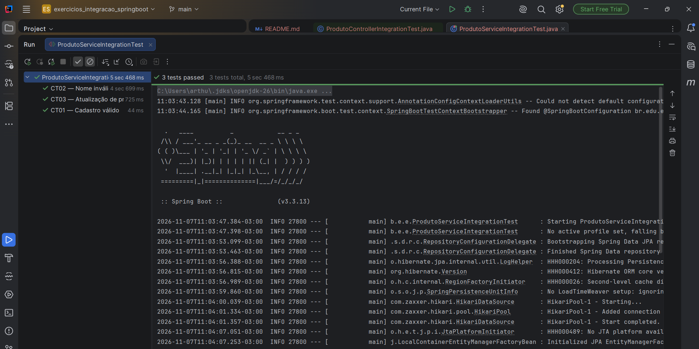
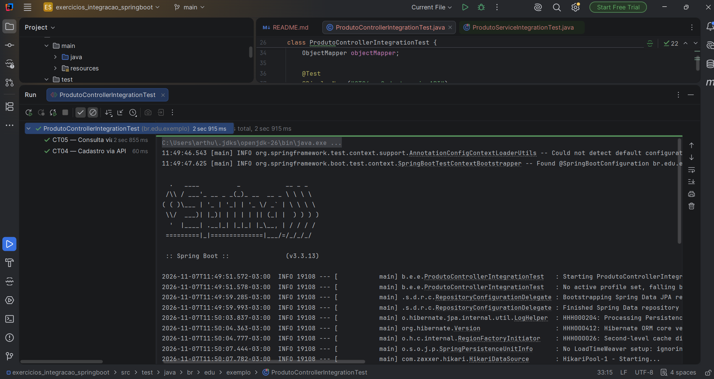

# Testes de integração com Spring Boot e JUnit 5

Projeto-base fornecido na SEMANA11 (Java 17, Maven, Spring Boot 3.3.13, Spring Data JPA, H2, JUnit 5 e MockMvc).
O código de `src/main` **não foi alterado**: apenas os testes com `TODO` foram completados.
Nenhum mock foi usado: `ProdutoRepository` e `ProdutoService` são os beans reais, com banco H2 em memória.

## Como executar

```bash
mvn test
```

## Testes implementados

### Exercício 1 — Service + Repository + H2 (`ProdutoServiceIntegrationTest`)

|Caso|Método|O que faz|Verificação|
|-|-|-|-|
|CT01|`deveCadastrarERecuperarProduto`|Cadastra `Teclado` por `150.0`|ID não nulo; ao buscar no repositório, nome e preço corretos|
|CT02|`naoDevePersistirProdutoComNomeEmBranco`|Tenta cadastrar nome em branco com preço `80.0`|`IllegalArgumentException`; `repository.count()` igual ao valor anterior|
|CT03 (desafio)|`deveAtualizarPrecoPersistido`|Cadastra `Mouse` por `80.0` e atualiza para `95.0`|`repository.findById()` retorna preço `95.0`|

Em CT01 e CT03 foi usado `entityManager.flush()` seguido de `entityManager.clear()` antes do `findById()`.
Isso envia as alterações ao H2 e esvazia o cache da sessão, forçando a consulta a ir realmente ao banco.

### Exercício 2 — HTTP com MockMvc (`ProdutoControllerIntegrationTest`)

|Caso|Método|Requisição|Verificação|
|-|-|-|-|
|CT04|`deveCadastrarProdutoPelaApi`|`POST /produtos` com `{"nome":"Mouse","preco":80.0}`|HTTP 200; `$.id` numérico, `$.nome` = `Mouse`, `$.preco` = `80.0`|
|CT05|`deveBuscarProdutoPelaApi`|`POST /produtos`, extrai o ID com `ObjectMapper`/`JsonNode` e faz `GET /produtos/{id}`|HTTP 200; JSON da consulta igual ao produto cadastrado|

## Evidência da execução

Resultado de `mvn test` no IntelliJ (JDK 26, Spring Boot 3.3.13):

**Exercício 1 — ProdutoServiceIntegrationTest (CT01, CT02, CT03): 3 testes passando**



**Exercício 2 — ProdutoControllerIntegrationTest (CT04, CT05): 2 testes passando**



## Discussão

### Exercício 1

**Por que `repository.findById()` fornece uma evidência diferente de verificar apenas o objeto retornado pelo serviço?**
O objeto devolvido por `service.cadastrar()` é o mesmo que estava em memória; conferir seus campos só prova que o serviço montou o objeto. Ao buscar pelo repositório, mostramos que o registro foi gravado e pode ser lido de volta da persistência.
Para essa evidência valer de fato, os testes fazem `flush()` e `clear()` antes: dentro de uma transação, o `findById()` poderia devolver a própria instância já guardada no cache da sessão, sem consultar o H2.

**O que `@Transactional` faz ao término de cada teste?**
Por padrão, o Spring faz **rollback** da transação ao final de cada método de teste. Os dados inseridos em um teste são desfeitos, então um teste não interfere no outro (isolamento) e a ordem de execução não importa.

### Exercício 2

**Quais componentes são efetivamente exercitados?**
Todo o fluxo: roteamento do Spring MVC, `ProdutoController`, desserialização e serialização JSON (Jackson), `ProdutoService` (com suas validações), `ProdutoRepository` (Spring Data JPA), Hibernate e o banco H2.

**Por que o MockMvc não precisa iniciar um servidor HTTP real?**
O MockMvc chama o `DispatcherServlet` do Spring diretamente, na mesma JVM, simulando a requisição e a resposta. Não há porta de rede, Tomcat nem conexão HTTP, mas o processamento do Spring MVC acontece normalmente.

**Qual é a diferença entre esse teste e um teste unitário do controller com dependências simuladas?**
No teste unitário, `ProdutoService` seria um mock: só se verifica se o controller chama o serviço e devolve o que ele retorna. Aqui as dependências são as implementações reais, então o teste também detecta falhas de validação, de persistência, de mapeamento JPA e de conversão JSON, que um teste com mocks não enxergaria.

